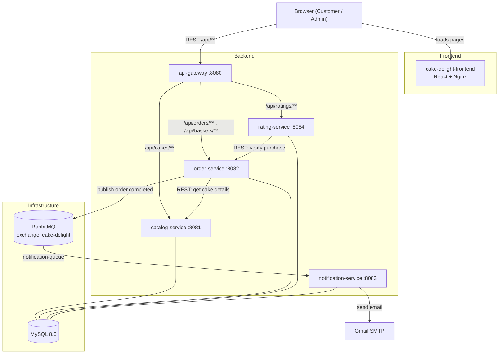
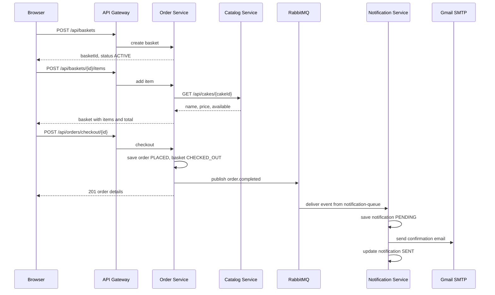
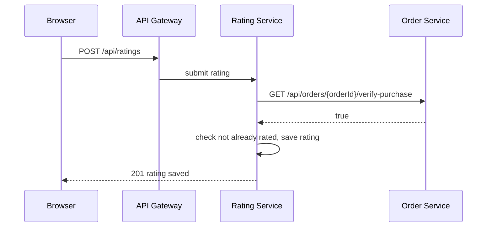

# Cake Delight – Cloud Native Microservices Engineering

**Capstone Project**
**Author:** Srihari Mittapally

Cake Delight is an online cake shop built as a set of independent Spring Boot microservices behind an API Gateway, with a React web frontend. The whole system is containerised with Docker, run locally with Docker Compose, and deployed on Kubernetes (Docker Desktop). Customers browse cakes, fill a basket, check out, receive an order-confirmation email and rate the cakes they bought.

---

## Table of Contents

1. [Project at a Glance](#1-project-at-a-glance)
2. [Technology Stack](#2-technology-stack)
3. [System Architecture](#3-system-architecture)
4. [Repository Structure](#4-repository-structure)
5. [Ports and Service Names](#5-ports-and-service-names)
6. [Services in Detail](#6-services-in-detail)
7. [API Gateway Routing](#7-api-gateway-routing)
8. [Complete API Summary](#8-complete-api-summary)
9. [End-to-End Business Flows](#9-end-to-end-business-flows)
10. [Databases](#10-databases)
11. [Configuration and Environment Variables](#11-configuration-and-environment-variables)
12. [Prerequisites](#12-prerequisites)
13. [Execution Guide – Stage 1: Docker Compose](#13-execution-guide--stage-1-docker-compose)
14. [Execution Guide – Stage 2: Kubernetes (Docker Desktop)](#14-execution-guide--stage-2-kubernetes-docker-desktop)
15. [Quick Verification Checklist](#15-quick-verification-checklist)
16. [Documentation Index](#16-documentation-index)

---

## 1. Project at a Glance

| Item | Detail |
|---|---|
| Project name | Cake Delight |
| Theme | Cloud Native Microservices Engineering |
| Architecture style | Microservices, API Gateway, database per service, event-driven messaging |
| Backend | 5 Spring Boot applications (gateway + 4 services) |
| Frontend | React single-page application served by Nginx |
| Messaging | RabbitMQ (order-completed event) |
| Data | MySQL 8.0, one database per service |
| Packaging | Docker (multi-stage builds), Docker Compose |
| Orchestration | Kubernetes on Docker Desktop |

### What the application does

- Browse cakes and filter them by name, category and price range.
- Create a basket, add cakes, change quantities, remove items.
- Check out the basket with name, email and delivery address to create an order.
- Receive an order-confirmation email automatically (asynchronously, through RabbitMQ).
- View past orders by email address.
- Rate and review each cake that was purchased (one rating per cake per order).
- See the average rating of every cake on the cakes page.
- Use a demo Admin Dashboard to add cakes, delete cakes and switch cake availability.

---

## 2. Technology Stack

| Layer | Technology | Version |
|---|---|---|
| Language | Java | 21 |
| Backend framework | Spring Boot | 4.1.2 |
| API Gateway | Spring Cloud Gateway Server WebMVC | Spring Cloud 2025.1.4 |
| Persistence | Spring Data JPA, Hibernate | managed by Spring Boot |
| Validation | Jakarta Bean Validation | managed by Spring Boot |
| Messaging client | Spring AMQP | managed by Spring Boot |
| Mail | Spring Mail (Gmail SMTP) | managed by Spring Boot |
| Build tool | Maven | 3.9.9 (inside Docker build) |
| Database | MySQL | 8.0 |
| Message broker | RabbitMQ (management image) | 4 |
| Frontend | React, React Router, Vite | 19.3.1, 7.18.5, 8.3.8 |
| Frontend runtime | Node (build), Nginx (serve) | Node 22, nginx:alpine |
| Containers | Docker, Docker Compose | Docker Desktop |
| Orchestration | Kubernetes | Docker Desktop Kubernetes |

---

## 3. System Architecture

### 3.1 Logical architecture



### 3.2 Design principles used

| Principle | How it is applied |
|---|---|
| Single entry point | The browser talks only to the API Gateway on port 8080. |
| Database per service | Each service owns its own MySQL database; no service reads another service's tables. |
| Synchronous communication | Order → Catalog (cake price and availability) and Rating → Order (purchase verification) use REST. |
| Asynchronous communication | Order → Notification uses a RabbitMQ topic exchange, so checkout does not wait for email delivery. |
| Layered services | controller → service → repository → entity, with DTOs and mappers between layers. |
| Externalised configuration | All hosts, ports and credentials come from environment variables; nothing environment-specific is hard-coded. |
| Containerised deployment | Every component has a Dockerfile (or an official image) and a Kubernetes manifest. |

### 3.3 Request path in each environment

| Environment | Browser opens | Frontend calls API at |
|---|---|---|
| Docker Compose | `http://localhost:3000` | `http://localhost:8080/api` |
| Kubernetes (port-forward) | `http://localhost:3000` | `http://localhost:8080/api` |

The frontend image is built with the default API address `http://localhost:8080/api`. The browser itself calls the gateway, so **the gateway must always be reachable on `localhost:8080`**, and the frontend must be opened on `localhost:3000` (the gateway allows only the origins `http://localhost:3000`, `http://localhost:5173` and `http://localhost:4173`).

---

## 4. Repository Structure

```text
capstone/
├── README.md                       Root documentation (this file)
├── DOCUMENTATION.txt               Plain-text project documentation
├── docs/                           Extra documentation (architecture, API, database, testing ...)
│
├── api-gateway/                    Spring Cloud Gateway – single entry point
│   ├── src/main/java/com/cakedelight/gateway/
│   │   ├── config/CorsConfig.java
│   │   └── filter/RequestLoggingFilter.java
│   ├── src/main/resources/application.properties
│   ├── Dockerfile
│   └── README.md
│
├── catalog-service/                Cake catalog (products)
│   ├── src/main/java/com/cakedelight/catalog/
│   │   ├── controller/  dto/  entity/  mapper/  repository/  service/
│   ├── src/main/resources/         application.properties, schema.sql, data.sql
│   ├── Dockerfile
│   └── README.md
│
├── order-service/                  Baskets, checkout, orders, event publisher
│   ├── src/main/java/com/cakedelight/order/
│   │   ├── client/  config/  controller/  dto/  entity/
│   │   ├── event/  exception/  repository/  service/  util/
│   ├── Dockerfile
│   └── README.md
│
├── rating-service/                 Ratings and reviews
│   ├── src/main/java/com/cakedelight/rating/
│   │   ├── client/  controller/  dto/  entity/  repository/  service/
│   ├── Dockerfile
│   └── README.md
│
├── notification-service/           RabbitMQ consumer + order confirmation email
│   ├── src/main/java/com/cakedelight/notification/
│   │   ├── config/  dto/  entity/  event/  listener/  repository/  service/
│   ├── Dockerfile
│   └── README.md
│
├── cake-delight-frontend/          React + Vite application
│   ├── src/                        api/  components/  context/  pages/  styles/  utils/
│   ├── Dockerfile                  Build with Node, serve with Nginx
│   └── README.md
│
├── docker/                         Docker Compose setup
│   ├── docker-compose.yml
│   ├── .env.example
│   ├── init/01-create-databases.sql
│   └── README.md
│
└── k8s/                            Kubernetes manifests
    ├── namespace.yaml  config.yaml  secret.yaml
    ├── mysql.yaml  rabbitmq.yaml
    ├── catalog-service.yaml  order-service.yaml  rating-service.yaml
    ├── notification-service.yaml  api-gateway.yaml  frontend.yaml
    └── README.md
```

---

## 5. Ports and Service Names

| Component | Container port | Docker Compose (host) | Kubernetes Service name | How it is reached in Kubernetes |
|---|---|---|---|---|
| Frontend (Nginx) | 80 | 3000 | `frontend` | port-forward `3000:80` |
| API Gateway | 8080 | 8080 | `api-gateway` | port-forward `8080:8080` |
| Catalog Service | 8081 | 8081 | `catalog-service` | internal only (ClusterIP) |
| Order Service | 8082 | 8082 | `order-service` | internal only (ClusterIP) |
| Notification Service | 8083 | 8083 | `notification-service` | internal only |
| Rating Service | 8084 | 8084 | `rating-service` | internal only (ClusterIP) |
| MySQL | 3306 | 3307 | `mysql` | internal only (ClusterIP) |
| RabbitMQ (AMQP) | 5672 | 5672 | `rabbitmq` | internal only (ClusterIP) |
| RabbitMQ Management UI | 15672 | 15672 | `rabbitmq` | optional port-forward `15672:15672` |

All Kubernetes Services are of type `ClusterIP`. No NodePort is used; the project is accessed through `kubectl port-forward` of the **api-gateway** and the **frontend** only.

---

## 6. Services in Detail

### 6.1 API Gateway (`api-gateway`, port 8080)

The single entry point of the backend. It contains no business logic.

- Routes every `/api/**` request to the correct service (see [section 7](#7-api-gateway-routing)).
- Applies CORS for the browser origins `http://localhost:3000`, `http://localhost:5173`, `http://localhost:4173` (methods GET, POST, PUT, PATCH, DELETE, OPTIONS).
- Logs every incoming request (method and URI) through `RequestLoggingFilter`.
- Exposes Actuator endpoints: `/actuator/health`, `/actuator/info`, `/actuator/gateway`.
- Needs the environment variables `CATALOG_SERVICE_URL`, `ORDER_SERVICE_URL`, `RATING_SERVICE_URL`.

### 6.2 Catalog Service (`catalog-service`, port 8081)

Owns the cake products. Database `cake_catalog_db`, table `cakes`.

- Lists cakes with optional filters: `name` (partial match), `category`, `minPrice`, `maxPrice`. The public list returns only cakes that are available.
- Admin list returns all cakes, including unavailable ones.
- Gets, adds and deletes a cake; toggles a cake's availability.
- On startup, `schema.sql` creates the `cakes` table and `data.sql` inserts five sample cakes (Chocolate, Vanilla, Black Forest, Red Velvet, Strawberry) without creating duplicates.
- Hibernate runs in `validate` mode: the schema comes from `schema.sql`, not from Hibernate.

### 6.3 Order Service (`order-service`, port 8082)

Owns baskets and orders. Database `cake_order_db`, tables `baskets`, `basket_items`, `orders`, `order_items`.

- Creates a basket (status `ACTIVE`), adds cakes, updates quantities, removes items.
- When a cake is added, it calls the Catalog Service to read the cake name, price and availability, and stores a snapshot of them in the basket item.
- Checkout turns an `ACTIVE` basket into an order (status `PLACED`), marks the basket `CHECKED_OUT`, and publishes an `order.completed` event to RabbitMQ.
- Lists all orders, gets an order by ID, lists orders by customer email.
- Exposes a purchase-verification endpoint used by the Rating Service.

### 6.3.1 Rating Service (`rating-service`, port 8084)

Owns ratings and reviews. Database `cake_rating_db`, table `ratings`.

- Accepts a rating (1 to 5) and optional review for a cake in an order.
- Before saving, calls the Order Service to confirm that this email really purchased this cake in this order.
- Allows only one rating per cake per order (unique constraint on `order_id` + `cake_id`).
- Returns all reviews of a cake, the average rating and rating count of a cake, summaries for all rated cakes, and all ratings given by an email address.

### 6.4 Notification Service (`notification-service`, port 8083)

A background worker; it has no REST endpoints. Database `cake_notification_db`, table `notifications`.

- Listens on the durable queue `notification-queue`, bound to the topic exchange `cake-delight` with routing key `order.completed`.
- For every order event it stores a notification record (`PENDING`), sends an HTML order-confirmation email through Gmail SMTP, then updates the record to `SENT`, or `FAILED` if the mail could not be sent.
- A mail problem never affects the order: checkout has already succeeded.
- Needs `MAIL_USERNAME` and `MAIL_PASSWORD` (a Gmail app password).

### 6.5 Frontend (`cake-delight-frontend`, served by Nginx on port 80)

A React single-page application.

| Page | Route | Purpose |
|---|---|---|
| Home | `/` | Welcome page and how the shop works |
| Cakes | `/cakes` | List and filter cakes, add to basket, see average ratings |
| Basket | `/basket` | Change quantities, remove items, see total, check out |
| Orders | `/orders` | Enter an email, see orders, rate purchased cakes |
| Admin Dashboard | `/admin` | Demo page: add cake, delete cake, toggle availability |

- The basket ID is kept in the browser (`localStorage`) so the basket survives a refresh.
- There are no user accounts. A customer is identified by the email entered at checkout.
- All backend calls go through `src/api/` to the API Gateway.

### 6.6 Infrastructure components

| Component | Role |
|---|---|
| MySQL 8.0 | One server, four databases (`cake_catalog_db`, `cake_order_db`, `cake_notification_db`, `cake_rating_db`), created by `init/01-create-databases.sql` |
| RabbitMQ 4 (management) | Message broker; topic exchange `cake-delight`, queue `notification-queue` |

---

## 7. API Gateway Routing

| Route ID | Path predicate | Forwarded to |
|---|---|---|
| `catalog-service` | `/api/cakes/**` | Catalog Service (`CATALOG_SERVICE_URL`) |
| `order-service` | `/api/orders/**` | Order Service (`ORDER_SERVICE_URL`) |
| `basket-service` | `/api/baskets/**` | Order Service (`ORDER_SERVICE_URL`) |
| `rating-service` | `/api/ratings/**` | Rating Service (`RATING_SERVICE_URL`) |

The gateway forwards the path unchanged. For example, `GET http://localhost:8080/api/cakes` reaches `GET /api/cakes` on the Catalog Service.

---

## 8. Complete API Summary

All paths below are called on the gateway: `http://localhost:8080`. Full request and response bodies are in each service's README.

### Catalog

| Method | Path | Purpose | Success |
|---|---|---|---|
| GET | `/api/cakes` | List available cakes (optional `name`, `category`, `minPrice`, `maxPrice`) | 200 |
| GET | `/api/cakes/admin` | List all cakes including unavailable | 200 |
| GET | `/api/cakes/{id}` | Get one cake | 200 |
| POST | `/api/cakes` | Add a cake | 201 |
| PATCH | `/api/cakes/{id}/availability` | Toggle availability | 204 |
| DELETE | `/api/cakes/{id}` | Delete a cake | 204 |

### Basket and Orders

| Method | Path | Purpose | Success |
|---|---|---|---|
| POST | `/api/baskets` | Create an empty basket | 201 |
| POST | `/api/baskets/{basketId}/items` | Add a cake to the basket | 200 |
| GET | `/api/baskets/{basketId}` | Get the basket | 200 |
| PUT | `/api/baskets/{basketId}/items/{itemId}` | Change item quantity | 200 |
| DELETE | `/api/baskets/{basketId}/items/{itemId}` | Remove an item | 204 |
| POST | `/api/orders/checkout/{basketId}` | Check out the basket | 201 |
| GET | `/api/orders` | List all orders | 200 |
| GET | `/api/orders/{orderId}` | Get one order | 200 |
| GET | `/api/orders/customer?email=` | Orders of a customer | 200 |
| GET | `/api/orders/{orderId}/verify-purchase?email=&cakeId=` | Was this cake bought in this order by this email | 200 |

### Ratings

| Method | Path | Purpose | Success |
|---|---|---|---|
| POST | `/api/ratings` | Submit a rating | 201 |
| GET | `/api/ratings/cake/{cakeId}` | All reviews of a cake | 200 |
| GET | `/api/ratings/cake/{cakeId}/summary` | Average and count for a cake | 200 |
| GET | `/api/ratings/summary` | Summaries for all rated cakes | 200 |
| GET | `/api/ratings/customer?email=` | Ratings given by an email | 200 |

### Gateway

| Method | Path | Purpose |
|---|---|---|
| GET | `/actuator/health` | Gateway health |
| GET | `/actuator/gateway/routes` | Configured routes |

The Notification Service has no public API.

---

## 9. End-to-End Business Flows

### 9.1 Order placement and confirmation email



### 9.2 Rating a purchased cake



### 9.3 Walk-through with sample data (success responses)

Base URL: `http://localhost:8080`

**Step 1 – List cakes**

```http
GET /api/cakes
```

```json
[
  {
    "id": 1,
    "name": "Chocolate Cake",
    "description": "Rich chocolate cake with chocolate cream.",
    "category": "Birthday",
    "price": 500.00,
    "available": true,
    "imageReference": "https://example.com/images/chocolate-cake.jpg"
  }
]
```

**Step 2 – Create a basket**

```http
POST /api/baskets
```

```json
{
  "basketId": 1,
  "status": "ACTIVE",
  "items": [],
  "totalAmount": 0
}
```

**Step 3 – Add a cake to the basket**

```http
POST /api/baskets/1/items
Content-Type: application/json

{
  "cakeId": 1,
  "quantity": 2
}
```

```json
{
  "basketId": 1,
  "status": "ACTIVE",
  "items": [
    {
      "itemId": 1,
      "cakeId": 1,
      "cakeName": "Chocolate Cake",
      "unitPrice": 500.00,
      "quantity": 2,
      "subtotal": 1000.00
    }
  ],
  "totalAmount": 1000.00
}
```

**Step 4 – Check out**

```http
POST /api/orders/checkout/1
Content-Type: application/json

{
  "customerName": "Srihari",
  "customerEmail": "customer@example.com",
  "deliveryAddress": "Karimnagar, Telangana"
}
```

```json
{
  "orderId": 1,
  "customerName": "Srihari",
  "customerEmail": "customer@example.com",
  "deliveryAddress": "Karimnagar, Telangana",
  "totalAmount": 1000.00,
  "status": "PLACED",
  "createdAt": "2026-11-16T21:10:45.123456",
  "items": [
    {
      "orderItemId": 1,
      "cakeId": 1,
      "cakeName": "Chocolate Cake",
      "unitPrice": 500.00,
      "quantity": 2,
      "subtotal": 1000.00
    }
  ]
}
```

A confirmation email is then sent to `customer@example.com` by the Notification Service.

**Step 5 – Rate the cake**

```http
POST /api/ratings
Content-Type: application/json

{
  "orderId": 1,
  "cakeId": 1,
  "customerName": "Srihari",
  "customerEmail": "customer@example.com",
  "rating": 5,
  "review": "Very tasty and fresh."
}
```

```json
{
  "id": 1,
  "orderId": 1,
  "cakeId": 1,
  "customerName": "Srihari",
  "rating": 5,
  "review": "Very tasty and fresh.",
  "createdAt": "2026-11-16T21:12:03.456789"
}
```

**Step 6 – See the cake's rating summary**

```http
GET /api/ratings/cake/1/summary
```

```json
{
  "cakeId": 1,
  "averageRating": 5.0,
  "totalRatings": 1
}
```

---

## 10. Databases

One MySQL server hosts four databases. Each service uses only its own.

| Database | Owner | Tables |
|---|---|---|
| `cake_catalog_db` | catalog-service | `cakes` |
| `cake_order_db` | order-service | `baskets`, `basket_items`, `orders`, `order_items` |
| `cake_rating_db` | rating-service | `ratings` |
| `cake_notification_db` | notification-service | `notifications` |

How the schemas are created:

| Service | Method |
|---|---|
| catalog-service | `schema.sql` and `data.sql` run at startup (`ddl-auto=validate`) |
| order-service | Hibernate `ddl-auto=update` |
| rating-service | Hibernate `ddl-auto=update` |
| notification-service | Hibernate `ddl-auto=update` |

The four empty databases are created by `docker/init/01-create-databases.sql` (Docker Compose) and by the `mysql-init` ConfigMap in `k8s/mysql.yaml` (Kubernetes). MySQL data is kept in the named volume `mysql_data` (Docker Compose) and in the PersistentVolumeClaim `mysql-pvc`, 1Gi (Kubernetes).

---

## 11. Configuration and Environment Variables

| Variable | Used by | Meaning |
|---|---|---|
| `MYSQL_HOST`, `MYSQL_PORT` | catalog, order, rating, notification | MySQL address (`mysql` / `3306` in Docker and Kubernetes) |
| `MYSQL_USERNAME`, `MYSQL_PASSWORD` | catalog, order, rating, notification, MySQL | Database credentials (MySQL root password = `MYSQL_PASSWORD`) |
| `CAKE_CATALOG_DB` | catalog | `cake_catalog_db` |
| `CAKE_ORDER_DB` | order | `cake_order_db` |
| `CAKE_RATING_DB` | rating | `cake_rating_db` |
| `CAKE_NOTIFICATION_DB` | notification | `cake_notification_db` |
| `RABBITMQ_HOST`, `RABBITMQ_PORT` | order, notification | RabbitMQ address (`rabbitmq` / `5672`) |
| `RABBITMQ_USERNAME`, `RABBITMQ_PASSWORD` | order, notification, RabbitMQ | Broker credentials |
| `CATALOG_SERVICE_URL` | order, api-gateway | `http://catalog-service:8081` |
| `ORDER_SERVICE_URL` | rating, api-gateway | `http://order-service:8082` |
| `RATING_SERVICE_URL` | api-gateway | `http://rating-service:8084` |
| `MAIL_USERNAME`, `MAIL_PASSWORD` | notification | Gmail address and Gmail **app password** |

Where they are defined:

| Environment | Location |
|---|---|
| Docker Compose | `docker/.env` (copied from `docker/.env.example`) |
| Kubernetes, non-secret values | ConfigMap `cake-delight-config` (`k8s/config.yaml`) |
| Kubernetes, secret values | Secret `cake-delight-secrets` (`k8s/secret.yaml`) |

> Never commit real passwords. `docker/.env` and `k8s/secret.yaml` are git-ignored. Use a Gmail **app password** for `MAIL_PASSWORD`, not your normal Gmail password.

---

## 12. Prerequisites

| Tool | Needed for | Check |
|---|---|---|
| Docker Desktop | Containers, Compose, Kubernetes | `docker --version` |
| Docker Compose v2 | Stage 1 (bundled with Docker Desktop) | `docker compose version` |
| Kubernetes enabled in Docker Desktop | Stage 2 | Docker Desktop → Settings → Kubernetes → *Enable Kubernetes* |
| kubectl | Stage 2 | `kubectl version --client` |
| Gmail app password | Order-confirmation emails | Google Account → Security → App passwords |

JDK, Maven and Node are **not** required to run the project: the Dockerfiles build everything inside containers.

---

## 13. Execution Guide – Stage 1: Docker Compose

Run everything on one machine with Docker Compose. All commands are run from the `docker` folder.

### 13.1 Prepare the environment file

```bash
cd docker
cp .env.example .env
```

On Windows PowerShell use `copy .env.example .env`.

Open `.env` and set real values (the Docker defaults already match the service names):

```properties
MYSQL_HOST=mysql
MYSQL_PORT=3306
MYSQL_USERNAME=root
MYSQL_PASSWORD=your_mysql_password

CAKE_CATALOG_DB=cake_catalog_db
CAKE_ORDER_DB=cake_order_db
CAKE_NOTIFICATION_DB=cake_notification_db
CAKE_RATING_DB=cake_rating_db

RABBITMQ_HOST=rabbitmq
RABBITMQ_PORT=5672
RABBITMQ_USERNAME=cakedelight
RABBITMQ_PASSWORD=your_rabbitmq_password

CATALOG_SERVICE_URL=http://catalog-service:8081
ORDER_SERVICE_URL=http://order-service:8082
RATING_SERVICE_URL=http://rating-service:8084

MAIL_USERNAME=your_gmail_address
MAIL_PASSWORD=your_gmail_app_password
```

### 13.2 Build the images

```bash
docker compose build
```

This builds six images:

| Image | Built from |
|---|---|
| `cake-delight-catalog-service` | `../catalog-service` |
| `cake-delight-order-service` | `../order-service` |
| `cake-delight-notification-service` | `../notification-service` |
| `cake-delight-rating-service` | `../rating-service` |
| `cake-delight-api-gateway` | `../api-gateway` |
| `cake-delight-frontend` | `../cake-delight-frontend` |

Check them:

```bash
docker images | grep cake-delight
```

On PowerShell use `docker images | findstr cake-delight`.

### 13.3 Start all containers

```bash
docker compose up -d
```

(`docker compose up -d --build` builds and starts in one command.)

### 13.4 Verify

```bash
docker compose ps
docker compose logs -f api-gateway
```

Stop following logs with `Ctrl + C`. All services should be `running`. On the first start, MySQL needs a little time; if a service stopped because the database was not ready yet, run `docker compose up -d` again.

### 13.5 Open the application

| What | URL |
|---|---|
| Web application | http://localhost:3000 |
| API through the gateway | http://localhost:8080/api/cakes |
| Gateway health | http://localhost:8080/actuator/health |
| RabbitMQ management | http://localhost:15672 (login with the RabbitMQ values from `.env`) |
| MySQL from the host | `localhost:3307` |

### 13.6 Stop

```bash
docker compose down
```

To also delete the database volume (all data):

```bash
docker compose down -v
```

> Before starting Stage 2, run `docker compose down`. Docker Compose and the Kubernetes port-forwards both use ports 8080 and 3000.

---

## 14. Execution Guide – Stage 2: Kubernetes (Docker Desktop)

All pods run inside the `cake-delight` namespace. The Kubernetes manifests use the **same image names** built in Stage 1 (`cake-delight-*:latest`, `imagePullPolicy: IfNotPresent`), so Docker Desktop Kubernetes uses the local images directly. Run all commands from the project root (`capstone/`).

### 14.1 Make sure the images exist

```bash
docker images | grep cake-delight
```

If any are missing, build them again:

```bash
cd docker
docker compose build
cd ..
```

### 14.2 Select the Kubernetes cluster

```bash
kubectl config get-contexts
kubectl config use-context docker-desktop
kubectl config current-context
kubectl cluster-info
kubectl get nodes
```

The node `docker-desktop` must show `Ready`.

### 14.3 Create the namespace

```bash
kubectl apply -f k8s/namespace.yaml
kubectl get namespaces
```

Optional: make `cake-delight` the default namespace so that `-n cake-delight` can be omitted.

```bash
kubectl config set-context --current --namespace=cake-delight
```

### 14.4 Create the ConfigMap and the Secret

```bash
kubectl apply -f k8s/config.yaml
kubectl apply -f k8s/secret.yaml
```

`k8s/secret.yaml` is git-ignored. Create it from the template in [k8s/README.md](k8s/README.md) with your own values. It must contain the keys `MYSQL_USERNAME`, `MYSQL_PASSWORD`, `RABBITMQ_USERNAME`, `RABBITMQ_PASSWORD`, `MAIL_USERNAME`, `MAIL_PASSWORD`.

```bash
kubectl get configmap -n cake-delight
kubectl get secrets -n cake-delight
kubectl describe configmap cake-delight-config -n cake-delight
```

### 14.5 Deploy the infrastructure (MySQL and RabbitMQ)

```bash
kubectl apply -f k8s/mysql.yaml
kubectl apply -f k8s/rabbitmq.yaml
kubectl get pods -n cake-delight
kubectl get pvc -n cake-delight
```

Wait until the `mysql` and `rabbitmq` pods are `Running` and `1/1`.

### 14.6 Deploy the backend services

```bash
kubectl apply -f k8s/catalog-service.yaml
kubectl apply -f k8s/order-service.yaml
kubectl apply -f k8s/rating-service.yaml
kubectl apply -f k8s/notification-service.yaml
kubectl apply -f k8s/api-gateway.yaml
```

### 14.7 Deploy the frontend

```bash
kubectl apply -f k8s/frontend.yaml
```

### 14.8 Check everything is running

```bash
kubectl get pods -n cake-delight
kubectl get pods -n cake-delight -w
kubectl get svc -n cake-delight
kubectl get deployments -n cake-delight
kubectl get all -n cake-delight
```

Press `Ctrl + C` to leave watch mode. All pods must be `Running` and `1/1`. If a service pod restarts a few times at first, it started before MySQL or RabbitMQ was ready; Kubernetes restarts it automatically.

### 14.9 Access the application with port-forward

No NodePort or Ingress is used. Open **two separate terminals** and keep both running.

**Terminal 1 – API Gateway**

```bash
kubectl port-forward -n cake-delight svc/api-gateway 8080:8080
```

**Terminal 2 – Frontend**

```bash
kubectl port-forward -n cake-delight svc/frontend 3000:80
```

Now open:

| What | URL |
|---|---|
| Web application | http://localhost:3000 |
| API through the gateway | http://localhost:8080/api/cakes |
| Gateway health | http://localhost:8080/actuator/health |

Use exactly these ports: the frontend calls `http://localhost:8080/api` from the browser, and the gateway allows the origin `http://localhost:3000`.

Optional, to see RabbitMQ (third terminal):

```bash
kubectl port-forward -n cake-delight svc/rabbitmq 15672:15672
```

Open http://localhost:15672 and log in with the RabbitMQ values from `secret.yaml`.

### 14.10 Useful operations

```bash
kubectl logs -n cake-delight deployment/order-service
kubectl logs -n cake-delight deployment/notification-service -f
kubectl describe pod <pod-name> -n cake-delight
kubectl rollout restart deployment/order-service -n cake-delight
kubectl scale deployment/catalog-service --replicas=2 -n cake-delight
kubectl exec -it deployment/mysql -n cake-delight -- mysql -uroot -p
```

After rebuilding an image, restart its deployment so the pod picks up the new image:

```bash
kubectl rollout restart deployment/<name> -n cake-delight
```

### 14.11 Clean up

Remove the whole project from the cluster:

```bash
kubectl delete namespace cake-delight
```

This deletes every pod, service, secret and the MySQL volume claim (all database data).

---

## 15. Quick Verification Checklist

| # | Check | Expected |
|---|---|---|
| 1 | `kubectl get pods -n cake-delight` (or `docker compose ps`) | All components running |
| 2 | Open http://localhost:8080/actuator/health | `"status":"UP"` |
| 3 | Open http://localhost:8080/api/cakes | JSON list of cakes |
| 4 | Open http://localhost:3000 | Cake Delight home page |
| 5 | Add a cake to the basket and check out | Order created, Orders page shows it |
| 6 | Check the customer's mailbox | Order-confirmation email received |
| 7 | Rate the cake on the Orders page | Stars appear; the average shows on the Cakes page |

---

## 16. Documentation Index

| Document | Content |
|---|---|
| [docs/DOCUMENTATION.txt](docs/DOCUMENTATION.txt) | Plain-text project documentation |
| [api-gateway/README.md](api-gateway/README.md) | Gateway routing, CORS, actuator |
| [catalog-service/README.md](catalog-service/README.md) | Catalog APIs, database, run steps |
| [order-service/README.md](order-service/README.md) | Basket and order APIs, events, run steps |
| [rating-service/README.md](rating-service/README.md) | Rating APIs, purchase verification, run steps |
| [notification-service/README.md](notification-service/README.md) | Event consumer, email, run steps |
| [cake-delight-frontend/README.md](cake-delight-frontend/README.md) | Pages, structure, run and build |
| [docker/README.md](docker/README.md) | Docker Compose in detail |
| [k8s/README.md](k8s/README.md) | Kubernetes manifests in detail |
| [docs/ARCHITECTURE.md](docs/ARCHITECTURE.md) | Architecture and design decisions |
| [docs/API-REFERENCE.md](docs/API-REFERENCE.md) | Consolidated API reference |
| [docs/DATABASE.md](docs/DATABASE.md) | Tables and columns of all databases |
| [docs/TESTING.md](docs/TESTING.md) | End-to-end test scenario |
| [docs/TROUBLESHOOTING.md](docs/TROUBLESHOOTING.md) | Common problems and fixes |

---

**Author:** Srihari Mittapally