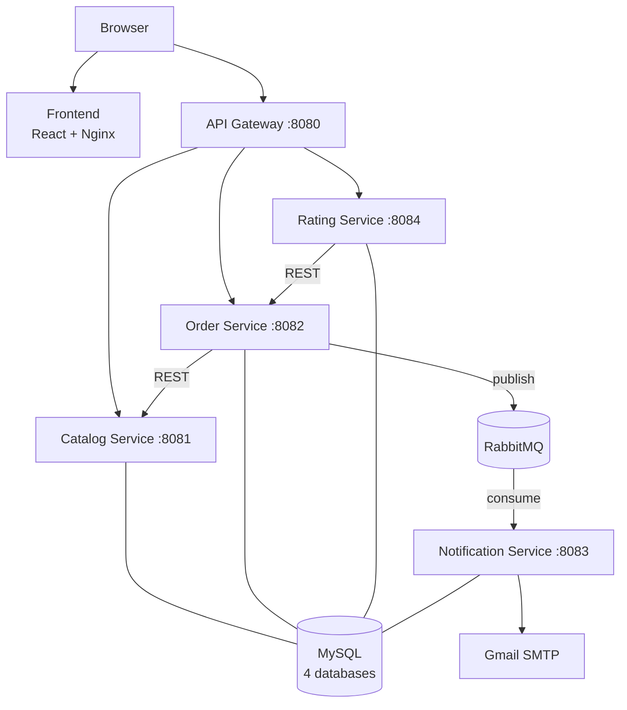
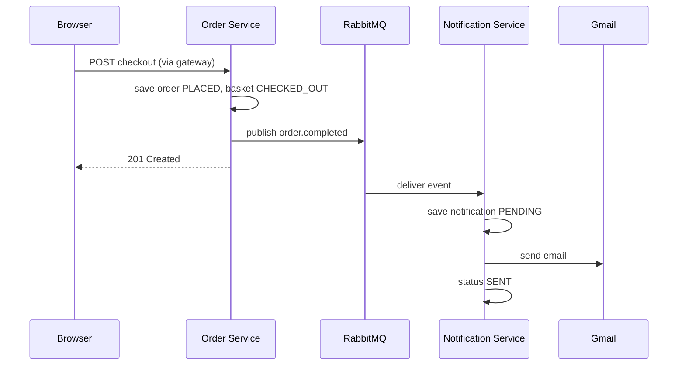
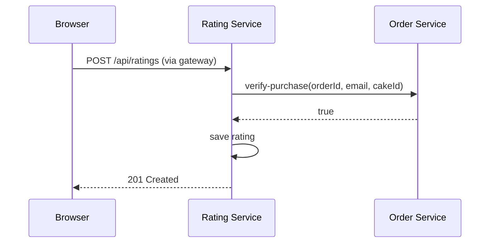
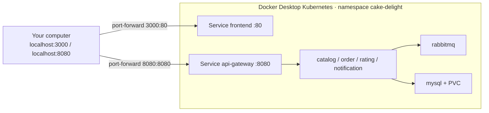

# Architecture

## 1. Overview

Cake Delight is a microservices system. A React frontend talks to one API Gateway; the gateway routes to three business services; one more service works in the background on RabbitMQ events. Each business service owns its own database.



## 2. Architectural style and why

| Decision | Reason |
|---|---|
| Microservices | Each business capability (catalog, orders, ratings, notifications) is small, independent and can be built, deployed and scaled on its own. |
| API Gateway | One address for the frontend, central CORS and request logging, services stay hidden behind it. |
| Database per service | Services stay independent; no shared tables. Each database can change without breaking another service. |
| REST between services | Used when an immediate answer is needed: price and availability from the catalog, purchase check from the order service. |
| Messaging (RabbitMQ) | Sending an email must not slow down or break checkout, so the order service only publishes an event and the notification service handles it later. |
| Data snapshot in orders | Basket and order items store the cake name and unit price at the time of purchase, so later catalog edits do not change old orders. |
| Layered services | controller → service → repository → entity, with DTOs and mappers, keep each class focused. |
| Externalised configuration | The same image runs in Docker and Kubernetes; only environment variables change. |

## 3. Components

| Component | Port | Owns | Talks to |
|---|---|---|---|
| Frontend | 80 (3000 on host) | – | API Gateway |
| API Gateway | 8080 | – | Catalog, Order, Rating |
| Catalog Service | 8081 | `cake_catalog_db` | – |
| Order Service | 8082 | `cake_order_db` | Catalog (REST), RabbitMQ (publish) |
| Rating Service | 8084 | `cake_rating_db` | Order (REST) |
| Notification Service | 8083 | `cake_notification_db` | RabbitMQ (consume), Gmail SMTP |
| MySQL | 3306 | – | – |
| RabbitMQ | 5672 / 15672 | – | – |

## 4. Communication

| Interaction | Type | Detail |
|---|---|---|
| Browser → Gateway | REST | `/api/**` on `localhost:8080` |
| Gateway → services | REST | Path based routing |
| Order → Catalog | REST (sync) | `GET /api/cakes/{id}` when a cake is added to a basket |
| Rating → Order | REST (sync) | `GET /api/orders/{orderId}/verify-purchase` before saving a rating |
| Order → Notification | Event (async) | Exchange `cake-delight`, routing key `order.completed`, queue `notification-queue` |

## 5. Main sequences

### Checkout and email



### Rating



## 6. Internal structure of a service

```text
HTTP request
    │
    ▼
Controller      receives the request, validates the body (@Valid)
    │
    ▼
Service         business rules, calls other services / publishes events
    │
    ▼
Repository      Spring Data JPA, talks to MySQL
    │
    ▼
Entity          mapped to a table

DTOs (request / response) and mappers separate the API from the entities.
```

## 5b. Messaging design

| Item | Value |
|---|---|
| Broker | RabbitMQ 4 |
| Exchange | `cake-delight`, type topic, durable |
| Routing key | `order.completed` |
| Queue | `notification-queue`, durable (declared by the Notification Service) |
| Payload | JSON (`OrderCompletedEvent`: order id, customer, address, total, items) |
| Producer | Order Service |
| Consumer | Notification Service |

## 7. Deployment architecture

| Aspect | Docker Compose | Kubernetes |
|---|---|---|
| Unit | 8 containers, one network | 8 Deployments + Services in namespace `cake-delight` |
| Configuration | `docker/.env` | ConfigMap `cake-delight-config` + Secret `cake-delight-secrets` |
| Database storage | volume `mysql_data` | PVC `mysql-pvc` (1Gi) |
| Database creation | `init/01-create-databases.sql` | ConfigMap `mysql-init` |
| Images | built by Compose | same `cake-delight-*:latest` images, `IfNotPresent` |
| Access | published ports (3000, 8080, ...) | `kubectl port-forward` of `api-gateway` (8080) and `frontend` (3000 → 80) |



## 8. Security overview

- Credentials are never in the code: they come from `.env` (Docker) or a Kubernetes Secret.
- Only the gateway and the frontend are exposed to the host in Kubernetes; all other services are ClusterIP.
- CORS on the gateway allows only the known frontend origins.
