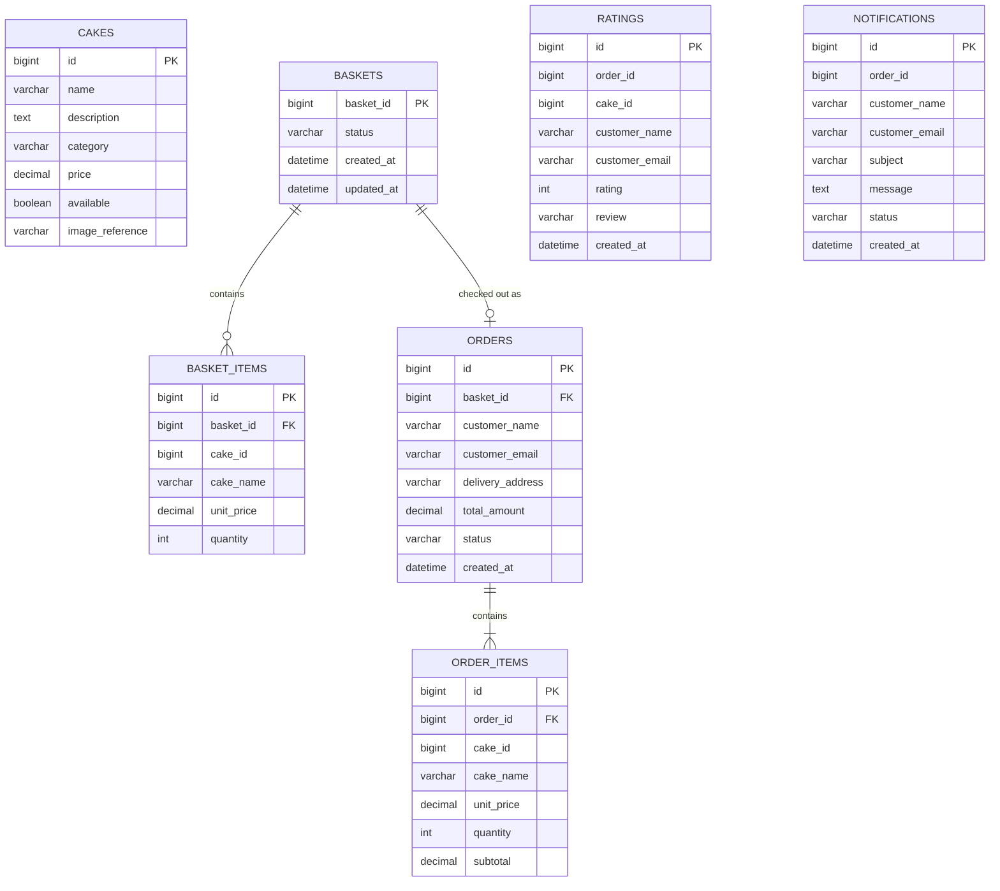

# Database Design

One MySQL 8.0 server hosts four databases, one per service. A service never reads another service's database.

| Database | Service | Schema created by |
|---|---|---|
| `cake_catalog_db` | catalog-service | `schema.sql` + `data.sql` (Hibernate `validate`) |
| `cake_order_db` | order-service | Hibernate `ddl-auto=update` |
| `cake_rating_db` | rating-service | Hibernate `ddl-auto=update` |
| `cake_notification_db` | notification-service | Hibernate `ddl-auto=update` |

The four empty databases are created by `docker/init/01-create-databases.sql` (Docker Compose) and by the `mysql-init` ConfigMap (Kubernetes), only when MySQL starts with an empty data directory.

## 1. Relationship overview



`cake_id` and `order_id` in other services' tables are plain numbers (references by value). There are no foreign keys across databases.

## 2. `cake_catalog_db`

### `cakes`

| Column | Type | Notes |
|---|---|---|
| `id` | BIGINT | PK, auto-increment |
| `name` | VARCHAR(150) | not null |
| `description` | TEXT | |
| `category` | VARCHAR(100) | not null |
| `price` | DECIMAL(10,2) | not null |
| `available` | BOOLEAN | not null, default true |
| `image_reference` | VARCHAR(500) | |

Sample data: Chocolate Cake, Vanilla Cake, Black Forest Cake, Red Velvet Cake, Strawberry Cake.

## 3. `cake_order_db`

### `baskets`

| Column | Type | Notes |
|---|---|---|
| `basket_id` | BIGINT | PK, auto-increment |
| `status` | VARCHAR(20) | `ACTIVE`, `CHECKED_OUT` |
| `created_at` | DATETIME | set on insert |
| `updated_at` | DATETIME | set on update |

### `basket_items`

| Column | Type | Notes |
|---|---|---|
| `id` | BIGINT | PK, auto-increment |
| `basket_id` | BIGINT | FK → `baskets.basket_id` |
| `cake_id` | BIGINT | cake in the catalog |
| `cake_name` | VARCHAR(150) | copy at the time of adding |
| `unit_price` | DECIMAL(10,2) | copy at the time of adding |
| `quantity` | INT | at least 1 |

Unique: (`basket_id`, `cake_id`) – a cake appears once per basket.

### `orders`

| Column | Type | Notes |
|---|---|---|
| `id` | BIGINT | PK, auto-increment |
| `basket_id` | BIGINT | FK → `baskets`, unique (one order per basket) |
| `customer_name` | VARCHAR(150) | |
| `customer_email` | VARCHAR(255) | |
| `delivery_address` | VARCHAR(500) | |
| `total_amount` | DECIMAL(10,2) | sum of item subtotals |
| `status` | VARCHAR(20) | `PLACED` |
| `created_at` | DATETIME | set on insert |

### `order_items`

| Column | Type | Notes |
|---|---|---|
| `id` | BIGINT | PK, auto-increment |
| `order_id` | BIGINT | FK → `orders.id` |
| `cake_id` | BIGINT | |
| `cake_name` | VARCHAR(150) | |
| `unit_price` | DECIMAL(10,2) | |
| `quantity` | INT | |
| `subtotal` | DECIMAL(10,2) | `unit_price × quantity` |

## 4. `cake_rating_db`

### `ratings`

| Column | Type | Notes |
|---|---|---|
| `id` | BIGINT | PK, auto-increment |
| `order_id` | BIGINT | |
| `cake_id` | BIGINT | |
| `customer_name` | VARCHAR(150) | |
| `customer_email` | VARCHAR(255) | |
| `rating` | INT | 1 to 5 |
| `review` | VARCHAR(1000) | optional |
| `created_at` | DATETIME | set on insert |

Unique `uk_order_cake_rating`: (`order_id`, `cake_id`) – one rating per cake per order.

## 5. `cake_notification_db`

### `notifications`

| Column | Type | Notes |
|---|---|---|
| `id` | BIGINT | PK, auto-increment |
| `order_id` | BIGINT | |
| `customer_name` | VARCHAR(255) | |
| `customer_email` | VARCHAR(255) | |
| `subject` | VARCHAR(255) | |
| `message` | TEXT | |
| `status` | VARCHAR(255) | `PENDING`, `SENT`, `FAILED` |
| `created_at` | DATETIME | set on insert |

## 6. Useful queries

```sql
SHOW DATABASES;

USE cake_catalog_db;
SELECT id, name, category, price, available FROM cakes;

USE cake_order_db;
SELECT id, customer_email, total_amount, status, created_at FROM orders;
SELECT order_id, cake_name, quantity, subtotal FROM order_items;

USE cake_rating_db;
SELECT order_id, cake_id, rating, review FROM ratings;

USE cake_notification_db;
SELECT order_id, customer_email, status FROM notifications;
```

Open a MySQL shell:

```bash
docker exec -it cake-delight-mysql mysql -uroot -p
```

```bash
kubectl exec -it deployment/mysql -n cake-delight -- mysql -uroot -p
```